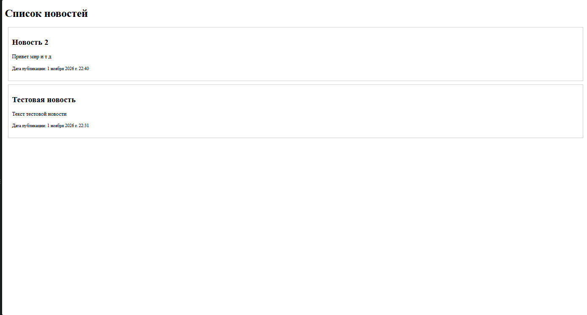
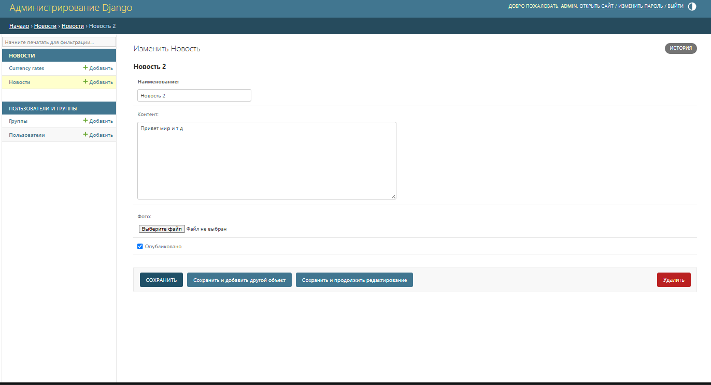
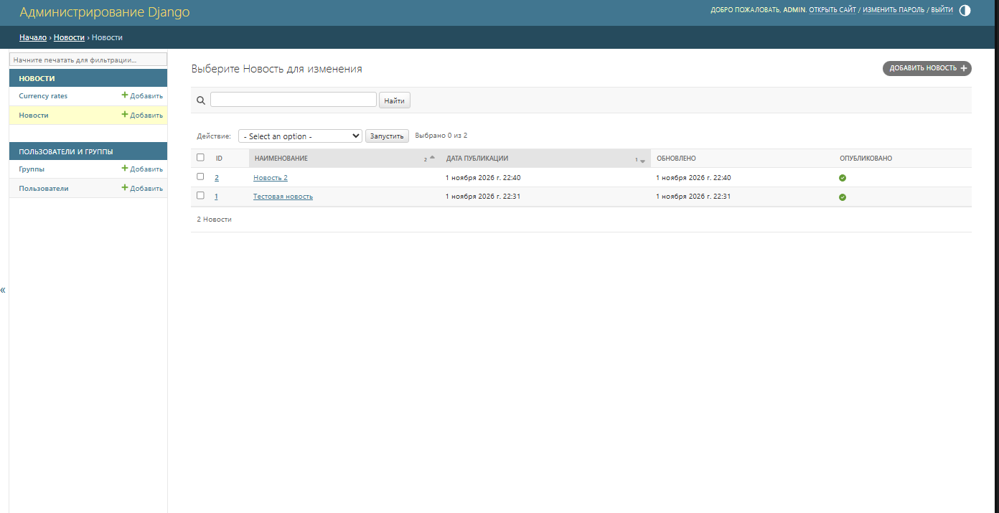
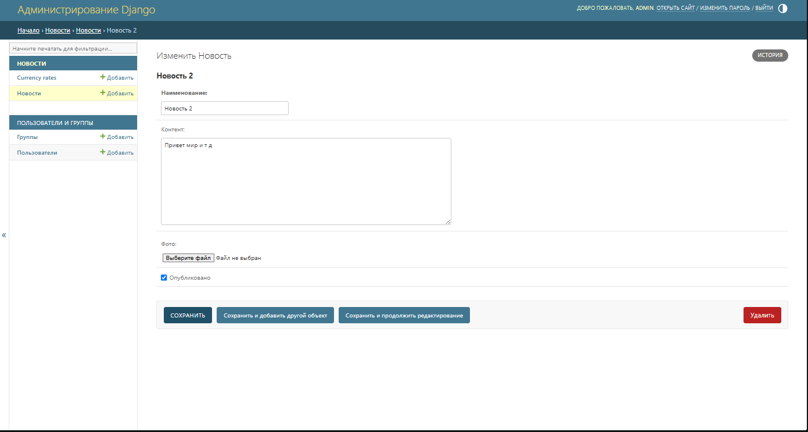

# Лабораторная работа №3: Шаблоны и панель администратора Django

**Тема:** Шаблоны Django, отображение данных из базы данных и настройка панели администратора.

## Содержание

- [Цель работы](#цель-работы)
- [Теоретическое обоснование](#теоретическое-обоснование)
- [Структура проекта](#структура-проекта)
- [Установка и запуск](#установка-и-запуск)
- [Реализация лабораторной работы](#реализация-лабораторной-работы)
  - [Получение данных и рендеринг шаблона](#получение-данных-и-рендеринг-шаблона)
  - [Модель News](#модель-news)
  - [Настройка панели администратора](#настройка-панели-администратора)
- [Скриншоты результатов](#скриншоты-результатов)
- [Контрольные вопросы](#контрольные-вопросы)
- [Выводы](#выводы)
- [Список использованной литературы](#список-использованной-литературы)

## Цель работы

Изучить механизм шаблонов Django и научиться отображать данные из базы данных на HTML-странице. Освоить передачу данных из представления (View) в шаблон с помощью контекста, использование тегов и фильтров шаблонизатора, а также настройку панели администратора Django: регистрацию моделей, изменение подписей полей, настройку отображаемых столбцов и поиска.

## Теоретическое обоснование

**Шаблон Django** — HTML-файл, в который можно передавать динамические данные из Python-представления. Шаблонизатор Django позволяет формировать страницу на основе данных, полученных из базы данных.

Основные элементы языка шаблонов Django:

- **Переменные** — выводят значения, переданные в шаблон через контекст. Например, `{{ title }}`.
- **Теги** — управляют формированием HTML-разметки. Например, ``, ``, ``.
- **Фильтры** — преобразуют значения перед выводом. Например, позволяют изменить формат даты.

**Рендеринг** — процесс формирования HTML-страницы на основе шаблона и переданных в него данных. В Django для этого используется функция `render()`.

**Контекст** — словарь, содержащий данные, которые представление передаёт шаблону.

**Панель администратора Django** — встроенный интерфейс для управления данными приложения. Модели регистрируются в админке, после чего записи можно просматривать, создавать, изменять и удалять.

## Структура проекта

Основные файлы и каталоги проекта:

```text
lab_3-web_app-main/
├── manage.py
├── db.sqlite3
├── MySite/
│   ├── settings.py
│   ├── urls.py
│   ├── asgi.py
│   └── wsgi.py
└── news/
    ├── migrations/
    │   ├── 0001_initial.py
    │   └── 0002_news_alter_currencyrate_change_percent.py
    ├── templates/
    │   └── news/
    │       └── index.html
    ├── admin.py
    ├── apps.py
    ├── models.py
    ├── views.py
    └── tests.py
```

Назначение основных файлов:

- `manage.py` — выполнение команд управления Django-проектом.
- `MySite/settings.py` — настройки проекта, подключённые приложения, база данных и параметры локализации.
- `MySite/urls.py` — маршруты проекта.
- `news/models.py` — модели данных `News` и `CurrencyRate`.
- `news/views.py` — представление, которое получает новости и передаёт их шаблону.
- `news/templates/news/index.html` — HTML-шаблон страницы со списком новостей.
- `news/admin.py` — регистрация моделей и настройка их отображения в админке.
- `news/apps.py` — конфигурация приложения `news`.
- `news/migrations/` — файлы миграций базы данных.

## Установка и запуск

Для запуска проекта необходим установленный Python.

1. Открыть терминал в корневой папке проекта, где находится файл `manage.py`.
2. Создать виртуальное окружение:

```bash
python -m venv venv
```

3. Активировать виртуальное окружение.

Windows:

```bash
venv\Scripts\activate
```

Linux / macOS:

```bash
source venv/bin/activate
```

4. Установить необходимые пакеты:

```bash
pip install django pillow
```

`Pillow` необходим для работы с полями изображений `ImageField`.

5. Применить миграции:

```bash
python manage.py migrate
```

6. При необходимости создать пользователя администратора:

```bash
python manage.py createsuperuser
```

Следовать инструкциям терминала: указать имя пользователя, адрес электронной почты (если требуется) и пароль.

7. Запустить сервер разработки:

```bash
python manage.py runserver
```

После запуска доступны следующие страницы:

- Список новостей: http://127.0.0.1:8000/news/
- Панель администратора: http://127.0.0.1:8000/admin/

Для входа в панель администратора используются данные суперпользователя, созданного командой `createsuperuser`.

## Реализация лабораторной работы

### Получение данных и рендеринг шаблона

В файле `news/views.py` импортируется модель `News` и функция `render`:

```python
from django.shortcuts import render
from .models import News


def index(request):
    news = News.objects.all()
    context = {
        'news': news,
        'title': 'Список новостей',
    }
    return render(request, 'news/index.html', context)
```

С помощью `News.objects.all()` получаются записи модели `News`. Затем создаётся словарь `context`, в котором находятся данные для передачи в шаблон. Функция `render()` формирует HTML-страницу и возвращает её пользователю.

Маршрут страницы новостей подключён в `MySite/urls.py`:

```python
from django.contrib import admin
from django.urls import path
from news.views import index

urlpatterns = [
    path('admin/', admin.site.urls),
    path('news/', index),
]
```

В шаблоне `news/templates/news/index.html` используется цикл `` для перебора новостей. Для каждой записи выводятся название, содержание и дата публикации. Тег `` отображает сообщение, если список новостей пуст:

```html
<h1>Список новостей</h1>

    <div>
        <h2>{{ item.title }}</h2>
        <p>{{ item.content }}</p>
        <p><small>Дата публикации: {{ item.created_at }}</small></p>
    </div>

    <p>Новостей пока нет.</p>

```

### Модель News

В файле `news/models.py` описана модель `News`, предназначенная для хранения новостей:

| Поле | Тип | Назначение |
|---|---|---|
| `title` | `CharField` | Наименование новости |
| `content` | `TextField` | Содержание публикации |
| `created_at` | `DateTimeField` | Дата и время публикации |
| `updated_at` | `DateTimeField` | Дата последнего изменения |
| `photo` | `ImageField` | Изображение новости |
| `is_published` | `BooleanField` | Статус публикации |

Для полей заданы русскоязычные подписи с помощью параметра `verbose_name`. Поля `content` и `photo` допускают пустое значение благодаря `blank=True`.

В модели также определён вложенный класс `Meta`:

```python
class Meta:
    verbose_name = 'Новость'
    verbose_name_plural = 'Новости'
    ordering = ['-created_at', 'title']
```

`verbose_name` и `verbose_name_plural` задают названия модели в единственном и множественном числе. Параметр `ordering` определяет порядок сортировки записей: сначала отображаются более новые новости, затем используется сортировка по названию.

В проекте также присутствует модель `CurrencyRate`, содержащая код валюты, курс, дату и процент изменения. Она зарегистрирована в панели администратора.

### Настройка панели администратора

В файле `news/admin.py` модель `News` регистрируется в админке вместе с классом настройки `NewsAdmin`:

```python
from django.contrib import admin
from .models import News, CurrencyRate


class NewsAdmin(admin.ModelAdmin):
    list_display = ('id', 'title', 'created_at', 'updated_at', 'is_published')
    list_display_links = ('id', 'title')
    search_fields = ('title', 'content')


admin.site.register(News, NewsAdmin)
admin.site.register(CurrencyRate)
```

Используются следующие параметры:

- `list_display` — определяет столбцы списка новостей: ID, наименование, дату публикации, дату обновления и статус публикации.
- `list_display_links` — задаёт поля, по которым можно перейти к редактированию записи.
- `search_fields` — добавляет поиск по названию и содержимому новости.

В `news/apps.py` для приложения задано русскоязычное название:

```python
class NewsConfig(AppConfig):
    default_auto_field = 'django.db.models.BigAutoField'
    name = 'news'
    verbose_name = 'Новости'
```

В `MySite/settings.py` настроены русский язык и московский часовой пояс:

```python
LANGUAGE_CODE = 'ru'
TIME_ZONE = 'Europe/Moscow'

USE_I18N = True
USE_TZ = True
```

Это позволяет использовать русскую локализацию интерфейса Django и соответствующие настройки времени.

После изменения структуры моделей создаются и применяются миграции:

```bash
python manage.py makemigrations
python manage.py migrate
```

## Скриншоты результатов

Для подтверждения выполнения лабораторной работы необходимо добавить четыре скриншота. Изображения следует сохранить в папке `scrin` в корне проекта.

### 1. Главная страница новостей



*Результат работы шаблона `index.html` и отображение списка новостей из базы данных.*

На скриншоте должна быть открыта страница `http://127.0.0.1:8000/news/`. Желательно, чтобы были видны карточки новостей, их названия, содержание и даты публикации.

### 2. Главная страница панели администратора



*Русификация панели управления и регистрация моделей в `admin.py`.*

На скриншоте должна быть открыта страница `http://127.0.0.1:8000/admin/` после авторизации. Должен быть виден раздел приложения «Новости».

### 3. Список новостей в панели администратора



*Настройка отображения модели `News` через класс `NewsAdmin` (колонки и поиск).*

На скриншоте должна быть открыта таблица новостей. В соответствии с текущим кодом `list_display` настроены пять столбцов: ID, наименование, дата публикации, обновлено и опубликовано. Также должна быть видна строка поиска.

### 4. Форма добавления или редактирования новости



*Форма редактирования записи с локализованными полями модели.*

На скриншоте должна быть открыта форма добавления или редактирования новости. В ней должны быть видны русскоязычные подписи полей: «Наименование», «Контент», «Фото», даты и статус публикации.

## Контрольные вопросы

**1. Что такое шаблон Django?**

Шаблон Django — это файл, обычно HTML, в котором с помощью переменных, тегов и фильтров формируется страница с динамическими данными.

**2. Для чего используется функция `render()`?**

Функция `render()` получает HTTP-запрос, имя шаблона и контекст, после чего формирует HTML-ответ для пользователя.

**3. Что такое контекст шаблона?**

Контекст — это словарь, который содержит данные, передаваемые из представления в шаблон.

**4. Для чего используются теги `` и ``?**

`` выполняет перебор элементов коллекции. `` позволяет вывести содержимое, если коллекция не содержит элементов.

**5. Для чего используются фильтры шаблонизатора?**

Фильтры преобразуют значения перед их отображением в шаблоне, например позволяют изменить формат даты или строкового значения.

**6. Что такое модель Django?**

Модель — это описание структуры данных приложения. Django использует модели для взаимодействия с базой данных через ORM.

**7. Для чего нужен вложенный класс `Meta` в модели?**

Класс `Meta` задаёт дополнительные параметры модели, например названия в единственном и множественном числе и порядок сортировки записей.

**8. Для чего используется `verbose_name`?**

`verbose_name` задаёт понятное человеку название поля или модели, которое отображается, в частности, в панели администратора.

**9. Для чего нужна регистрация модели в `admin.py`?**

Регистрация позволяет управлять записями модели через встроенную панель администратора Django.

**10. За что отвечают `list_display`, `list_display_links` и `search_fields`?**

`list_display` задаёт столбцы таблицы записей, `list_display_links` определяет ссылки для перехода к редактированию, а `search_fields` задаёт поля, по которым выполняется поиск.

**11. Чем отличаются `null=True` и `blank=True`?**

`null=True` разрешает хранить в базе данных значение `NULL`. `blank=True` разрешает оставлять поле незаполненным при проверке данных и работе с формами Django.

**12. Для чего нужны миграции Django?**

Миграции позволяют переносить изменения структуры моделей в структуру базы данных. Команда `makemigrations` создаёт файлы миграций, а `migrate` применяет их.

## Выводы

В ходе выполнения лабораторной работы были изучены шаблоны Django и механизм передачи данных из представления в HTML-шаблон. Реализовано получение записей модели `News` с помощью ORM и их отображение на странице новостей с использованием шаблонных переменных и тегов.

Также была изучена настройка панели администратора Django. Модель `News` зарегистрирована в админке, настроены отображаемые столбцы, ссылки для редактирования и поиск по полям. Для модели заданы русскоязычные названия, а в настройках проекта установлены русский язык и московский часовой пояс.

В результате была получена возможность просматривать новости на пользовательской странице и управлять записями через панель администратора Django.

## Список использованной литературы

1. Django Documentation — Templates: https://docs.djangoproject.com/en/6.1/topics/templates/
2. Django Documentation — The Django template language: https://docs.djangoproject.com/en/6.1/ref/templates/language/
3. Django Documentation — The Django admin site: https://docs.djangoproject.com/en/6.1/ref/contrib/admin/
4. Django Documentation — Model instance reference: https://docs.djangoproject.com/en/6.1/ref/models/instances/
5. Django Documentation — Model field reference: https://docs.djangoproject.com/en/6.1/ref/models/fields/
6. Django Documentation — Migrations: https://docs.djangoproject.com/en/6.1/topics/migrations/
